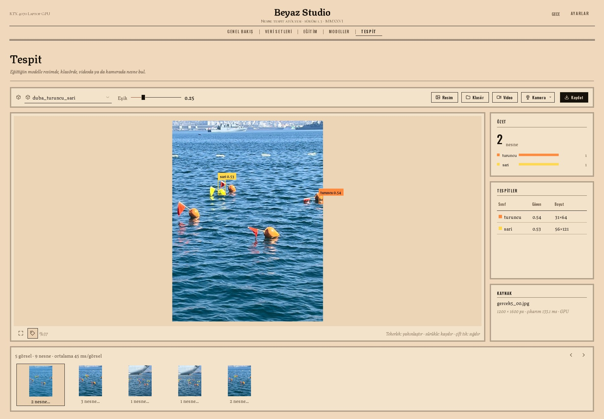
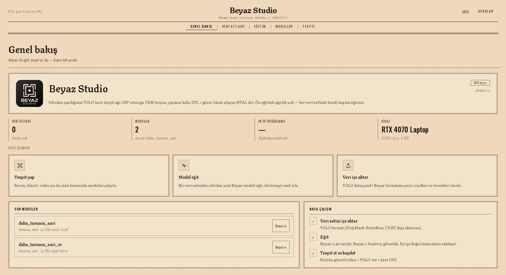
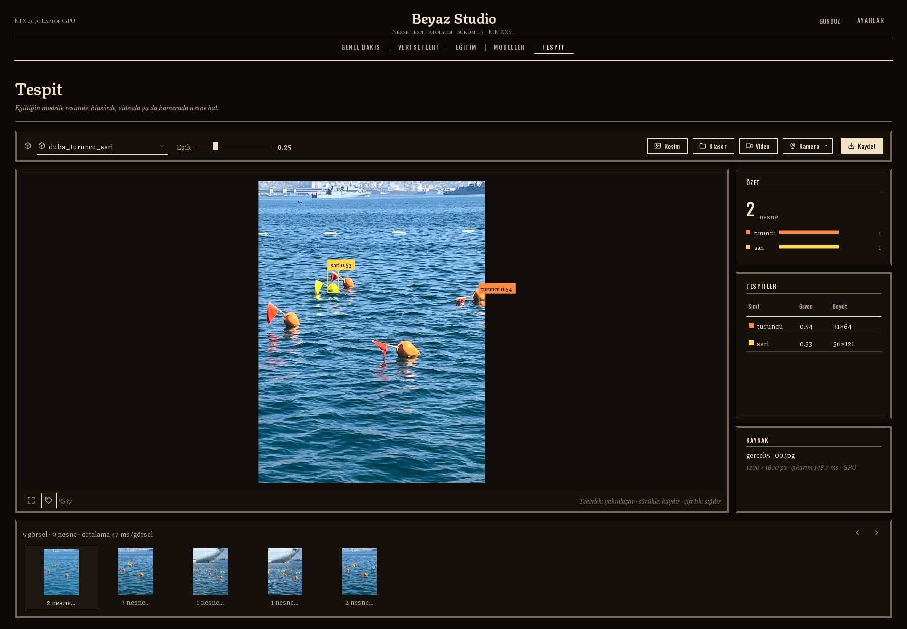

# Beyaz Studio

**Beyaz** is an object detection network written from scratch, and **Beyaz Studio** is its desktop app for
importing datasets, training, evaluating and running detection, all without the command line.

> This repository is a project showcase. The software is not distributed publicly.

**Current version: 1.3** — new "letterpress" interface with day and night themes. See [release notes](#release-notes).

## The network

- **Architecture:** YOLO-style. C2f/CSP backbone with SPPF, a PAN neck and a decoupled anchor-free head.
  Box regression uses Distribution Focal Loss, with a task-aligned assigner and CIoU + DFL + BCE losses.
- **No pretrained weights.** Every model learns its dataset from scratch.
- **Two sizes:** Beyaz-n (3.0 M parameters) and Beyaz-s (11.1 M).
- **Two tasks:** **Box** detection, and **Mask** segmentation through a prototype-mask head, trained on polygon
  labels from tools such as PolyMark Studio / SAM.
- **Default training method: STAL + EMA.** STAL keeps tiny objects from receiving zero candidate cells. EMA averages the
  weights over a ~200-step window. Analysis showed that the commonly used EMA schedule is effectively switched off
  in training runs this short.

### Results

On a small real-world buoy dataset (57 frames, 4-fold cross-validation × 3 seeds, mAP50):

| Model | mAP50 |
|---|---|
| Beyaz-n, STAL + EMA | **77.1 ± 3.0** |
| Beyaz-n, previous method | 74.0 ± 1.4 |
| YOLO11s, COCO-pretrained (single seed) | 73.8 |

- **STAL + EMA vs. previous method:** STAL + EMA won 10 of 12 paired folds (sign test p ≈ 0.02).
- **Mask mode regression check:** after mask mode was added, box training reproduces the old code bit for bit.

**Known limitation:** on an independent set of photos from a different camera and scene, accuracy drops sharply.
More varied data is the next step.

## The app

- **Datasets:** imports YOLO `data.yaml` folders, or PolyMark / Roboflow ZIP files without unpacking them, and
  shows per-class statistics and labeled previews.
- **Training:** runs in a separate process, so the UI never freezes. Shows a live progress ring, validation mAP50
  and loss curves, and **Stop** keeps the best weights so far.
- **Models:** per-class AP50, training history, evaluation on any dataset.
- **Detection:** works on images, folders, video and live camera. A threshold slider filters results instantly
  without re-running the model. Exports annotated images, YOLO labels and a CSV summary.
- **PolyMark Studio link:** datasets exported from PolyMark Studio appear in Beyaz Studio on their own, already
  selected on the Training page.
- **Interface:** an antique letterpress look: paper and ink colors, engraved typefaces, double-ruled frames. Day
  (paper) and night (ink) themes, an ink-wash transition and a rubber-stamp mark when a training run sets a new best
  score. Motion effects can be turned off in Settings.
- **Stack:** PyTorch, PySide6 and OpenCV, packaged with PyInstaller together with the CUDA runtime, so no Python
  installation is needed.

## Release notes

### 1.3 (November 2026)
- Datasets sent from PolyMark Studio are picked up live: a notice appears and the new set is preselected for training.
- The app remembers the last used workspace folder.
- New logo and app icon.

### 1.2 (November 2026)
- Completely redesigned interface: the sidebar is replaced by a centered masthead and menu. Paper/ink palette,
  Texturina, Oswald and Cormorant SC typefaces, double-ruled cards, a dial-style progress ring and hatched charts.
- Day and night themes, switchable from the masthead.
- Motion effects: an ink wash on start-up and theme change, and a rubber stamp on the "best score" tile when
  training improves. They can be switched off in Settings.

### 1.1 (October 2026)
- **Mask** task: instance segmentation with a prototype-mask head, trained on polygon labels.
- PolyMark / Roboflow ZIP files can be imported directly.
- Box training reproduces the previous version bit for bit.

### 1.0 (October 2026)
- First desktop release: datasets, training, models and detection pages.

## Author

© 2026 Ayberk KOCABUĞA. All rights reserved.
